# DeadlockScout

A self-improvement overlay for [Deadlock](https://store.steampowered.com/app/1422450/). It detects your match the moment the lobby forms, scouts the players, and shows your souls-per-minute against the pace of your hero at your rank, as a click-through window over the game.

- **Match detection** from the game's own `console.log` (with `-condebug`) and Steam's logs. No API calls.
- **Lobby scouting**: games on hero, win rate, rank, players you have met before, smurf flags, and likely parties tagged **Team 1**, **Team 2**... next to the names (scout list and main window) (teammates who have partied before, from public match records). On each enemy, a red **[!] counter item** when one is clear: the item that wins most for your hero when theirs is on the other team, from the last 30 days of matches at every rank, after taking out the matchup's own advantage and keeping only items well above noise (hover it for the numbers). Most heroes have none; `overlay.panels.counterItems` turns them off. Above the list, **one line per team** to compare them: rank spread, average games on hero, and their record and souls per minute on their heroes over the last 30 days against their usual ("Archon 2 – Oracle 1 · 84 games on hero · 30 days 41–29, +4% souls/min"); one call a match, `overlay.panels.teamForm` turns the 30 days off.
- **Soul-rate meter**: 2-minute rolling souls per minute against a per-hero, per-rank pace curve, with percentile when the data supports it, and a sparkline of your pace over the last ten minutes. Two thinner lines on the same sparkline track your lane opponents (or, without a lane, the two richest enemies) against the same curve, so a line above yours is farming faster; the legend under it gives their souls against yours ("Lady Geist +1.2k"). Their lines end where the broadcast is, about half a minute back (`overlay.panels.sparklineEnemies`). Under it, the **rank gate**: the next rank's average pace on your hero over the same window and how you stand against it ("Oracle gate 640 spm · you +5%"). The gate is the tier above yours, never below Alchemist unless you tick Initiate & Seeker in the match history (`goal.includeLowRanks`); `goal.rank` names a fixed tier instead, `goal.overlay` turns the line off. In a match those two lines only show while the scout list is up (Ctrl+Shift+L); the main window always shows them. In the strip's top row, **live phase chips** (laning, mid game, late game) show how each phase has gone against the goal so far, the current one outlined in gold, and while you are behind in laning or mid game a hint says what you need to catch up by the phase's end ("need 730 spm to 20:00 to catch Oracle"); `goal.phases` turns them off.
- **Lane matchups**: your hero's lane win rate against each lane opponent's hero at your rank, and under each opponent their **recent form**: their last ten games on that hero (record, souls per minute) against their usual pace on it, red when they are farming faster than usual ("last 10 on Lady Geist: 7–3 · 846/min, +9% on their usual"). One match-history call per lane opponent, cached a day; `overlay.panels.laneForm` turns it off.
- **Build hint**: what your hero's players buy at your current souls, with their win rate, and your next usual ability point. Under it, the **next item nudge**: your usual next big item on this hero (3,000 souls and up, from your last 30 games, skipping what you already own) and when the rank gate's players have it, "Next: Fortitude · Oracle has it by 14:44 · in 0:24", gold 30 s before and red once you are past it. `overlay.panels.nextItem` turns it off.
- **Real-time souls by OCR** (M6, opt in): draw boxes over your soul count, the match clock and the enemy scoreboard souls, and the built-in Windows OCR reads them once a second, so your pace no longer lags the broadcast by a minute. While you are dead the game shows a teammate's souls in your HUD's place; those readings are held back and dropped, so cycling through teammates no longer moves your souls per minute. Only those boxes are ever captured, never the rest of the screen, and nothing while OCR is off. Needs Windows 10 2004 or later and a Windows language with OCR support (English is).
- **Post-match report**: result, K/D/A, souls per minute, where you ranked on your team, your pace against the benchmark at 10, 20 and 30 minutes, how your lane went, and each phase against the rank above yours ("Against Oracle: laning +6% · mid game −9% · late game +6% · most lost in mid game"), shown in the main window and as a tray notice once deadlock-api has the match. Replay salts from your Steam cache are sent to deadlock-api automatically (once per match; `ingest.autoSubmitSalts`) so your matches get on record.
- **Match history**: your last 20 games with your rank over 30 days, win rate, KDA, main heroes and the last 15 results, then a card per game (result, hero, K/D/A, final items, souls and souls per minute, last hits, where your souls ranked on your team, both teams). Each card puts your total souls beside the K/D/A. Open a game for its **soul timeline** (your souls through the match, with every item you bought marked where you bought it, coloured by slot, and a dashed **rank gate**: the average souls on that hero of a rank you pick from a drop-down, Eternus down to Alchemist, starting on the tier above yours, with how far above or below it you finished, split into laning, mid game and late game chips; the timeline marks the three phases) and its **item purchases** in order, sold ones included. An **item timings** card lists the items you buy most with your average buy time against the rank gate's ("Headhunter 13:58 · Oracle 12:07 · +1:51"), and names the item furthest behind; each purchase on an opened game shows the rank's time and your gap too. A **phases** card pools laning (0–10 min), mid game (10–20) and late game (20+) over the page's games against the rank gate: your souls per minute and the rank's in each, how many souls a game you are behind or ahead, and which phase costs you the most. Above the cards, **trends** over your last 20, 50 or 100 games, for all heroes or one: rolling win rate and souls per minute (each game a dot coloured by result), the older half against the newer half for win rate, souls per minute and KDA, and a row per hero (games, W–L, win rate, KDA, souls per minute, last played), all from the history already fetched. **Soul sources**: an opened game lists where its souls came from (troopers, jungle, kills, objectives, the rest, and what you lost on death), each against the rank gate, and a card over the page names the source that costs you the most souls a game ("Troopers cost you the most: 1.2k souls a game behind Oracle"). **Weekly summary**: a "last week" card in the main window sets your last full week against the week before (games, record, rank change, souls per minute, the phase and item that improved most) and names one thing to work on next week. **Goals**: set your own targets in the match history (laning pace by 10:00, at most so many deaths in laning, a phase to fix against the rank gate); every game is marked hit or missed, and the card shows each target's hit rate over your last 20 games with a dot per game. **Death review**: each death on an opened game with the souls you were carrying unspent (red at 3k or more) and a cross on the soul timeline, the souls the rank gate gained while you were dead, and a card over the page ("Spend before you fight: 9 of 24 deaths came with 3k or more souls unspent"). **Counter notes**: an opened game lists each enemy hero with their counter items for the hero you played (the same measured items as the scout list's [!] tags, up to three, each marked bought or not in that game), and a **heroes that beat you** card names the enemy heroes you lose to most over the page (your W–L with them in the enemy line-up) with their counter items. One cached call per hero pair, made when a game is first opened. One bulk call fetches the games not seen before; a finished game is cached for good. From the main window or the tray.
- **Session view**: today's wins and losses, your streak, how your rank moved, a nudge after three losses in a row, and your most played heroes against their meta win rate at your rank. In the overlay only outside a match, and in the main window.
- **Benchmarks ready at match start**: between matches the app prefetches the accurate and personal pace curves for the heroes you play most.
- **Enemy pace board and lane card**, with **power-spike alerts**: when an enemy buys a 6,400-soul item, one of the items that lift their hero's win rate most at your rank, or unlocks their ultimate, their row flashes "just got Leech" for 30 seconds and then keeps the item as a chip with its icon. Beside it, **what they usually buy next**: the big item each enemy buys in at least half of their games on that hero, with their usual time ("next: Boundless Spirit ~34:08"), until they have it (hover for their whole usual order). One analytics call per enemy, cached a day; `overlay.panels.enemyTendencies` turns it off. Items come from the Direct live feed (the hosted feed has none); `overlay.panels.spikes` turns it off (see the milestones in [`docs/architecture-seed.md`](docs/architecture-seed.md)).
- **Audio cues** (opt-in, off by default): DeadlockScout's own short sounds, never the game's: two rising beeps when a laning timer says push now, a chime 30 s before the mid boss's estimated return or the next urn, and two falling tones after a minute more than 5% under the rank gate (at most every 3 minutes). Each has its own switch in Settings, with a volume slider and a Test button.
- **First-run wizard**: opens at the first start (and from the tray after): finds Steam, Deadlock and your account (or takes them typed), adds `-condebug` while Steam is closed, reads Deadlock's display mode from its `video.txt` and says if exclusive fullscreen would hide the overlay (the app never changes the game's settings), offers OCR with the calibration tool, and ends on the demo lobby. Each step shows a tick, a warning or a cross.
- **Diagnostics page**: from the main window's Diagnostics button or the tray. Setup and detection (Steam, Deadlock, console.log, the game window, `-condebug`, the live feed and OCR; moved here from the top of the main window, which now only shows a warning when something needs you), the last match (its live feed and any fallback, how long the roster took, the broadcast's delay, the game log's clock against the HUD clock, notes such as a broadcast that kept saying "not yet"), what the app uses right now (clock, souls source, OCR read rate, teammate readings dropped), and every API call since the app started: calls, errors, 429s and 404s per endpoint, average time and our own rate-limit waits, with the latest errors. **Copy diagnostics** puts it all on the clipboard for a bug report without account ids, player names, your Windows user name or the API key.
- **Settings window**: every option in one place, from the main window's Settings button or the tray: overlay panels, scout list and hotkeys, the rank gate, laning timers and their spawn times, objectives, audio cues, live feed and API key, benchmarks, OCR (with the calibration tool), and session and launch options. Changes apply at once and are written to settings.json; bad input is not saved and the field shows the stored value again.
- **Laning timers**: the jungle's first spawns (small camps 2:00, crates 3:00, medium camps and Midtown crates 5:00, large camps and Sinner's Sacrifice 8:00) counting down, each row turning gold with "push now" 30 seconds before its spawn so you shove your wave and are free when it appears, then green when it is up. The countdown runs on the game's live clock, not the 60–90 s late broadcast: the HUD clock when the OCR timer box is calibrated, else the console log's game-start line, else the broadcast plus an assumed delay (`timers.broadcastDelaySeconds`). Spawn times and the lead are in `timers.*`; the defaults come from community timer pages and are unverified. `overlay.panels.timers` turns it off.
- **Objectives**: when the mid boss died, who took its Rejuvenator and when it should be back, each team's Rejuvenator count, and when the urn appeared or was picked up. Times are game-clock times, so they line up with the in-game timer despite the broadcast delay. The broadcast has no respawn timers, so the mid boss's return is an estimate: 7 minutes until the app has seen one respawn in the match, then the observed delay (`objectives.midBossRespawnSeconds`; each observed delay is logged). Under them, **countdowns on the live clock** (the same one as the laning timers): "Mid boss back in 1:40" and "Next urn 15:00 · in 2:10", each turning gold 30 seconds before. The urn schedule (10:00, then every 5 minutes, `objectives.urnFirstSpawnSeconds`/`urnIntervalSeconds`) is checked against a real match; the app logs each urn it sees arrive. The objective lines need the Direct live feed; the urn countdown also works on the hosted feed. `overlay.panels.objectives` turns it off.

## Screenshots

The overlay at 1080p, drawn over a plain backdrop in place of the game: lane card with your lane matchup win rate and the opponent's recent form, pace strip with a second line for your own recent games on the hero and two enemies' lines on its sparkline, lobby scout list with three likely parties tagged, enemy pace board (one enemy has just bought a spike item; three show the item they usually buy next), objectives (the enemy took the mid boss at 11:20; the urn is out) and build hint.

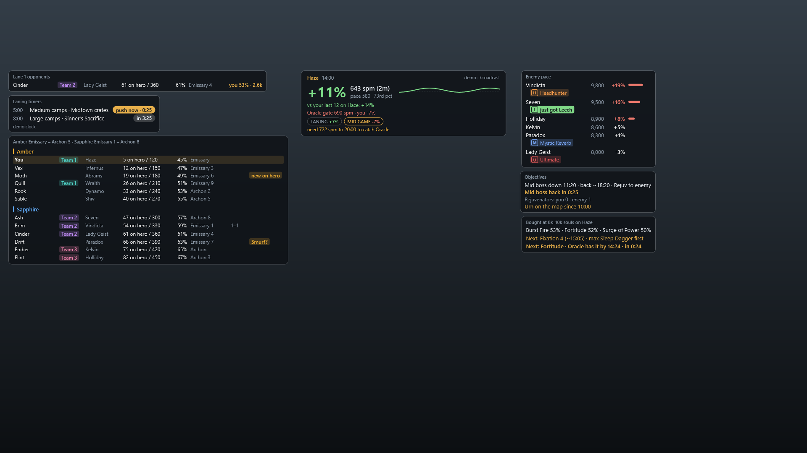

Power-spike alerts on the enemy pace board, at twice the size: Seven has just bought Leech, so their chip is filled for 30 seconds; Vindicta's Headhunter, Paradox's Mystic Reverb and Lady Geist's ultimate stay on as quiet chips. Beside the chips, the big item each enemy usually buys next on their hero, with their usual time. Chips are coloured by kind: red for the ultimate, orange for weapon, blue for spirit, green for vitality. In the app each chip shows the item's icon; screenshots show its initial instead, because they never show game art.

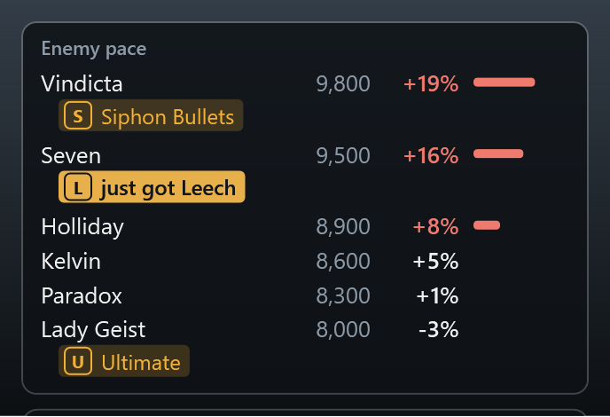

The pace strip as it shows in a fight: the live phase chips sit in its top row, and the two lines for your last games and the rank gate stay hidden until Ctrl+Shift+L brings up the scout list, when the strip grows to include them.

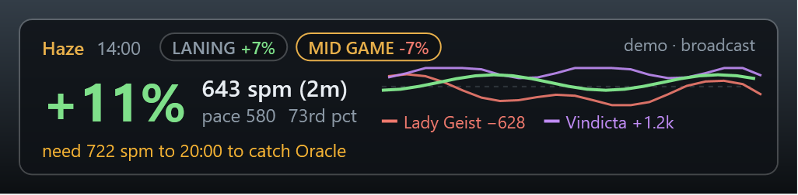

The preview doubles as the layout editor: every movable panel gets a gold outline and can be dragged anywhere, and the bar has a panel size slider.

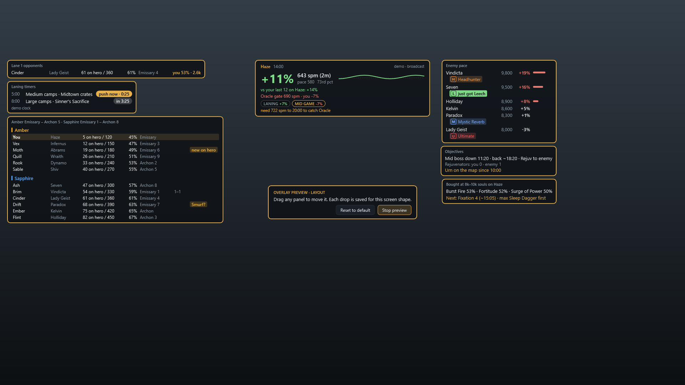

The match history with demo games: the summary row, the trends over 50 games, the goals with their hit rates, the heroes that beat you with their counter items, the phases, deaths, soul sources and item timings against Oracle, then a card per game; the first is open on its soul timeline, with the Oracle gate dashed over it, its goal and phase chips, where its souls came from and its deaths, its item purchases and the counter items for each enemy hero, marked bought or not. Item and hero squares show initials here, because screenshots never show game art; the app shows the icons.

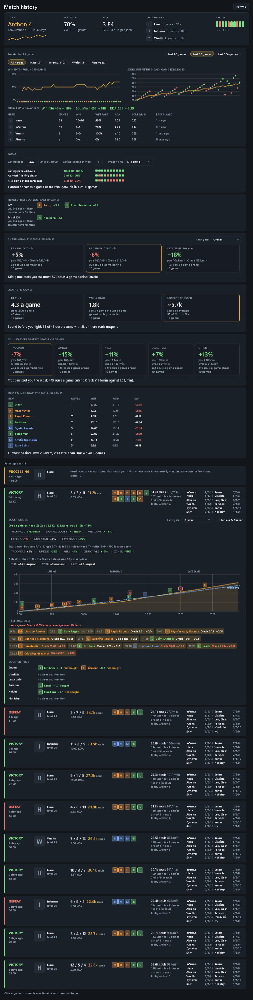

The app's own window frame: a dark title bar with the gold-ruled DeadlockScout name and flat caption buttons (close turns red), and slim scroll bars that widen and turn gold under the mouse, in place of Windows' white caption and grey bars. Radio buttons, check boxes and drop-downs follow the same theme. Snapping, resizing and double-click to maximise still work; on Windows 11 the corners stay round.

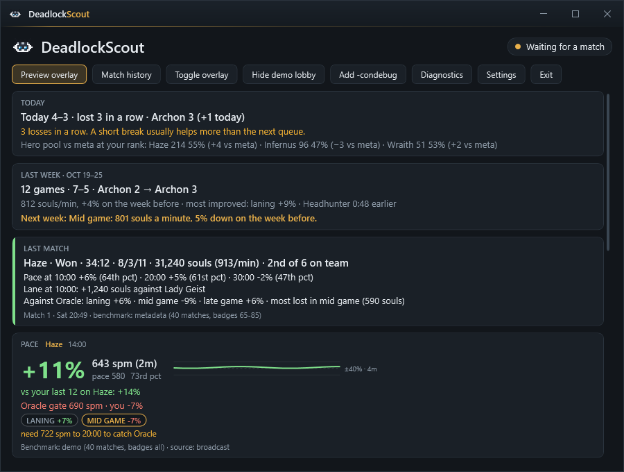

The main window with the same demo lobby, spike chips and team lines included, under today's session and last week's summary.

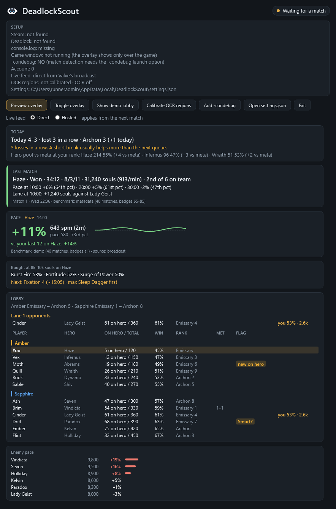

The first-run wizard on its Steam step, as a new player sees it on a PC without Steam (the screenshot runner's): the cross says what is missing and the fields take the folders by hand.

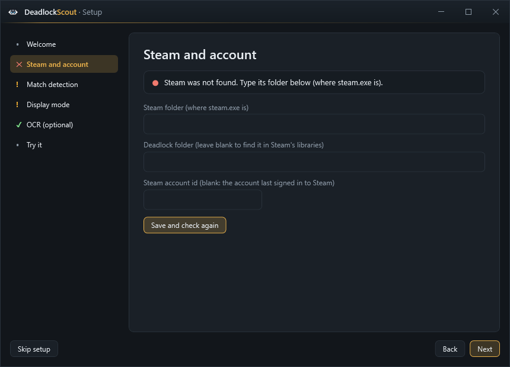

The settings window, every section with its defaults: overlay panels and hotkeys, rank gate, laning timers, objectives, audio cues, live feed, benchmarks, OCR, and session.

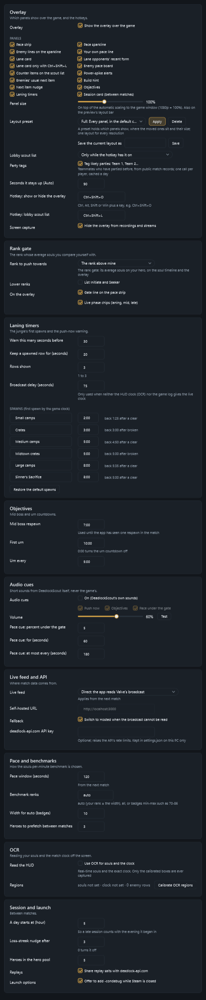

The diagnostics page with a made-up last match and API log (the setup lines are the screenshot runner's own).

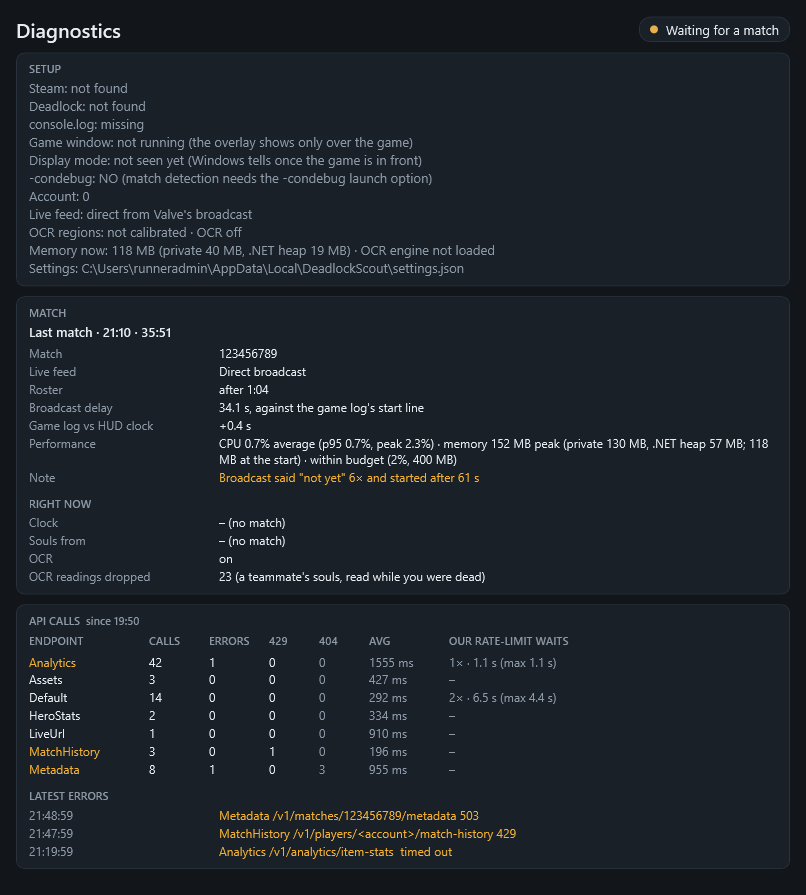

The OCR region tool, with example boxes over a plain backdrop. On a real machine it sits over the game, and the preview shows the live pixels of the selected box and what OCR reads from them.

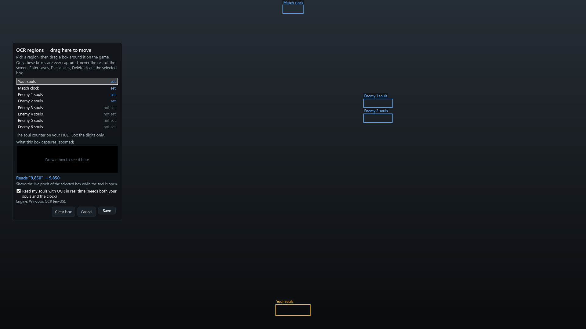

The overlay and main window shots use the app's demo lobby, with made-up player names. The Screenshots workflow renders them on a Windows runner (`DeadlockScout --screenshots <folder>`) whenever a branch changes the app, and commits them to that branch.

## Safety

DeadlockScout never touches the game process. It reads files the game and Steam write on purpose, draws an ordinary transparent window on top of the game, and talks to the public [deadlock-api.com](https://deadlock-api.com) service. No memory reading, no injection, no hooks, no input automation. The overlay requires **borderless windowed** mode; exclusive fullscreen hides every external window.

All match data comes from Valve's public spectator broadcast, which runs 60–90 seconds behind real time. The overlay labels every number with the game time it refers to.

## Setup

1. Add `-condebug` to Deadlock's launch options (Steam → Deadlock → Properties → Launch options), or use the app's **Add -condebug** button while Steam is closed. The console log is how the app notices your match.
2. Nothing to install for the live match feed. By default (`api.liveSource: "direct"` in settings) the app reads Valve's delayed public broadcast itself with the [DemoFile](https://github.com/saul/demofile-net) parser, vendored with fixes for the current patch (see `third_party/demofile-net/VENDORED.md`). Only the broadcast address comes from deadlock-api. If a game patch breaks parsing, the app switches that match to deadlock-api's hosted live query automatically.
   - `"hosted"` uses the hosted live query from the start.
   - **Settings → Live feed and API** switches between Direct, Hosted and Self-hosted and writes this setting. A change applies from the next match.
   - `"selfHosted"` uses the deadlock-api live-events container you run yourself, expected at `http://localhost:3000` (`api.liveUrl`). Setup guide: [live-events README](https://github.com/deadlock-api/deadlock-api/tree/master/live-events); image: [ghcr.io/deadlock-api/deadlock-live-events](https://github.com/orgs/deadlock-api/packages/container/package/deadlock-live-events).
     ```
     docker run -d --restart unless-stopped -p 3000:3000 ghcr.io/deadlock-api/deadlock-live-events:latest
     ```
   - The app writes every setting into `settings.json` on first run, so an install from before this default keeps `"liveSource": "hosted"` until you change it with the switch or in the file.
   - To check that the parser understands the current patch, run it on one of your replays or on a live broadcast URL (it also lists every objective change it reads, which is how the mid boss and urn reads get confirmed):
     ```
     dotnet run --project tools/DeadlockScout.ReplayCheck -- path\to\match.dem
     ```
3. Start DeadlockScout; it sits in the tray. Starting it mid-match is fine: it picks up a match already in progress from the game's log. Closing the main window hides it to the tray; **Exit** (in the window or the tray menu) quits, as does Ctrl+C in the terminal you started it from. Set Deadlock to **borderless windowed**.
4. To check the overlay outside a match, click **Preview overlay** in the main window (or the tray menu): it shows the overlay without the game in front, over your primary screen if the game is not running, filled with the demo lobby. Click **Stop preview** to go back to normal.
5. To move the overlay's panels, turn on **Preview overlay**. Only during a preview does the overlay take the mouse (over its panels; the rest of the screen still gets your clicks); in a match it is always click-through. The pace strip, lane card, scout list, enemy board, objectives, build hint and session card get a gold outline, and you drag them where you want. Each drop snaps to an 8 px grid, stays on screen, and is saved in `settings.json` (`overlay.positions`) for that screen shape, so a 1440p and an ultrawide layout are kept apart. **Panel size** (60–160%) scales every panel on top of the automatic scaling to the game window. **Reset to default** puts this screen shape's panels back; **Stop preview** (on the overlay or in the main window) ends it and makes the overlay click-through again.
6. **Settings → Overlay → Layout preset** switches whole layouts: **Full** (every panel), **Laning** (pace, lane card, timers, objectives, enemy pace) and **Minimal** (pace, timers, objectives, a little smaller), plus any you save under a name of your own (**Save the current layout as**). A preset sets which panels show, where the moved ones sit and their size; because the overlay already scales with the game window (1080p = 100%), one preset fits 1080p, 1440p and 4K alike.
6. Spectating works too: watch a live match from the Watch tab and the overlay shows every player's pace against their hero's curve (tagged A or S for the team) and, on Ctrl+Shift+L, the lobby stats. Panels about your own game stay empty, and no post-match report is made for someone else's match.
7. Hotkeys while you play: **Ctrl+Shift+L** shows or hides the lobby stats (the scout list, with each player's lane, and the lane card; also in the tray menu; `overlay.panels.laneWithScout` set to false keeps the lane card up all match), and **Ctrl+Shift+O** hides or shows the whole overlay. Both can be changed in `settings.json` (`overlay.hotkeyLayout`, `overlay.hotkeyToggle`); `overlay.panels.scout` set to `auto` brings back the scout list for the first 90 seconds of each match.

## Status

Pre-alpha. The solution builds on Windows and Linux and the logic is covered by unit tests. It has been run through real matches: match detection from console.log (start, end screen, leaving, starting the app mid-match), the Direct broadcast feed for a whole match, scouting, and the overlay over the game. [`docs/verification/api.md`](docs/verification/api.md) records what was checked against the API's source and real matches, what the design doc got wrong, and what is still open. [`docs/roadmap.md`](docs/roadmap.md) is the plan to 1.0, milestone by milestone.

## Building

Requires the .NET 10 SDK (10.0.100 or later; `global.json` pins the 10.0 band). `dotnet build` and `dotnet test` work on Windows, Linux and macOS (the WPF app builds everywhere with `EnableWindowsTargeting`, and runs on Windows 10/11).

```
dotnet build
dotnet test
dotnet run --project src/DeadlockScout.App     # Windows
```

Settings live in `%LOCALAPPDATA%\DeadlockScout\settings.json` and the cache in `cache.db` next to it. An API key is optional; set `api.apiKey` to raise your quota.

## Licence

BSD 3-Clause, see [LICENSE](LICENSE).
